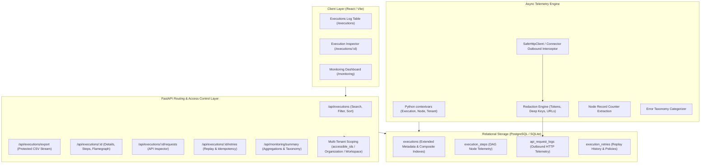

# Flowsmith Logs & Monitoring Telemetry Architecture

## 1. Executive Summary

Flowsmith's **Logs & Monitoring Module** provides enterprise-grade observability, execution inspection, and telemetry tracking for distributed DAG-based integration workflows. Drawing directly from **Cyclr's** industry-standard integration logging paradigms, Flowsmith records granular step outcomes, outbound HTTP requests/responses with automated secret redaction, record-level metrics (read, created, updated, skipped, failed, processed), retry tracking with idempotency safeguards, and an operational monitoring dashboard.

---

## 2. Cyclr vs. Flowsmith Capability Matrix

| Feature / Capability | Cyclr Integration Logs | Flowsmith Implementation | Status / Parity |
| :--- | :--- | :--- | :--- |
| **Centralized Execution Logs** | Paginated table with timestamp, connector, status, and transaction ID | Paginated log table with multi-attribute filtering (Status, Connector, Object, Trigger, Error Category, Date Range), sorting, and search | **Full Parity + Enhanced** |
| **Record-Level Counters** | Records read, created, updated, failed | Native counters for `records_read`, `records_created`, `records_updated`, `records_skipped`, `records_failed`, `records_processed` on execution and step levels | **Full Parity + Enhanced** |
| **API Request & Response Inspector** | Detailed inspection of HTTP calls made to 3rd-party connectors | Dedicated API Inspector tab displaying method, endpoint URL, status code, latency, headers, and request/response payloads with toggleable secret masking | **Full Parity** |
| **Secret Masking & Redaction** | Strips basic auth headers | Multi-layer redaction engine: Authorization/Bearer tokens, API keys, cookies, query parameter tokens, deep recursive JSON keys, and bounded truncation | **Exceeds Cyclr** |
| **Step-by-Step DAG Timeline** | Sequential run view | Visual DAG Timeline with duration waterfalls, node categorization, and error callout badges | **Full Parity** |
| **Error Taxonomy & Diagnostics** | Generic HTTP failure codes | Normalized error categorization (`NETWORK_ERROR`, `RATE_LIMIT`, `AUTHENTICATION`, `SCHEMA_VALIDATION`, `UPSTREAM_5XX`, `TIMEOUT`, `TRANSFORMATION_ERROR`) with user-friendly remediation summaries | **Exceeds Cyclr** |
| **Retry History & Idempotency** | Manual replay button | Idempotent replay engine with client-supplied idempotency keys, attempt linkage, backoff policy tracking, and replay audit logs | **Exceeds Cyclr** |
| **Monitoring Dashboard** | Basic transaction volume graphs | 8 Cyclr-style summary metric cards (Total, Success Rate, p95 Latency, Records Read/Processed/Failed, Active Retries) + Interactive Error Breakdown with 1-click log drill-down | **Full Parity + Enhanced** |
| **Data Export** | Basic CSV export | Secure CSV export with automatic spreadsheet formula injection protection (`=`, `+`, `-`, `@`, `\t`, `\r` escaping) | **Exceeds Cyclr** |

---

## 3. High-Level System Architecture



---

## 4. Telemetry Pipeline & Context Propagation

### 4.1 Asynchronous Context Correlation
During workflow execution in `backend/app/engine/executor.py` and `backend/app/execution_runtime.py`, concurrent DAG branches execute asynchronously. To correlate outbound API requests and node steps back to their parent execution without passing state down every internal method signature, Flowsmith utilizes Python standard library `contextvars`:

- `current_execution_id`: The ID of the currently executing workflow run.
- `current_workspace_id`: Tenant workspace ID for resource isolation.
- `current_organization_id`: Tenant organization ID.
- `current_node_id`: The specific node or step currently executing.

```python
# app/telemetry/context.py
import contextvars

current_execution_id: contextvars.ContextVar[str | None] = contextvars.ContextVar("current_execution_id", default=None)
current_node_id: contextvars.ContextVar[str | None] = contextvars.ContextVar("current_node_id", default=None)
current_workspace_id: contextvars.ContextVar[str | None] = contextvars.ContextVar("current_workspace_id", default=None)
current_organization_id: contextvars.ContextVar[str | None] = contextvars.ContextVar("current_organization_id", default=None)
```

### 4.2 Outbound HTTP Interception
Whenever an integration connector or HTTP node initiates an outbound network request via `SafeHttpClient` or `BaseNode`:
1. `record_api_call` captures the outbound request method, target URL, request headers, and payload.
2. The payload and headers immediately pass through `redact_headers`, `redact_url`, and `redact_payload`.
3. The response status code, response headers, elapsed duration, and response body are recorded.
4. Large payloads (>64KB) are cleanly truncated with `payload_truncated=True` to prevent database bloat.
5. The resulting telemetry row is persisted to `api_request_logs`.

### 4.3 Node Record Accounting
`telemetry_service.extract_node_record_counts(node_type, inputs, outputs)` inspects node input and output structures:
- Counts rows in lists, arrays, or batch objects (`records`, `items`, `rows`, `data`).
- Distinguishes created, updated, and failed records for connector nodes based on response payloads.
- Aggregates node counts into the execution-level counters (`records_read`, `records_created`, `records_updated`, `records_skipped`, `records_failed`, `records_processed`) upon workflow completion.

---

## 5. Database Schema & Indexing Strategy

### 5.1 `executions` Table Enhancements
Added columns:
- Multi-tenancy: `workspace_id` (VARCHAR 64), `organization_id` (VARCHAR 64).
- Record Counters: `records_read`, `records_created`, `records_updated`, `records_skipped`, `records_failed`, `records_processed` (INTEGER, DEFAULT 0).
- Cyclr Metadata: `source_connector`, `destination_connector`, `source_object`, `destination_object`, `http_method`, `api_endpoint`, `http_status_code`.
- Diagnostic Taxonomy: `error_type`, `error_code`, `error_summary`.
- Retry Tracking: `retry_count`, `original_execution_id`.

**Composite Indexes for Sub-10ms Queries:**
- `ix_executions_ws_status_started (workspace_id, status, started_at DESC)`
- `ix_executions_ws_started (workspace_id, started_at DESC)`
- `ix_executions_org_started (organization_id, started_at DESC)`
- `ix_executions_connector_status (source_connector, status)`
- `ix_executions_error_taxonomy (error_type, error_code)`

### 5.2 `execution_steps` Table
Normalizes DAG node traces for granular queryability without deserializing massive monolithic JSON execution blobs:
- `id` (VARCHAR 64, PK)
- `execution_id` (VARCHAR 64, FK to executions.id, ON DELETE CASCADE, INDEX)
- `node_id`, `node_type`, `step_name`, `operation`, `connector_id`
- `sequence_number` (INT, ordering within DAG)
- `status` (`success`, `failed`, `running`, `skipped`)
- `started_at`, `completed_at`, `duration_ms`
- `input_record_count`, `output_record_count`, `failed_record_count`
- `error_type`, `error_code`, `error_message`
- Indexed on `(execution_id, sequence_number)`, `(execution_id, node_id)`, and `(organization_id, started_at)`.

### 5.3 `api_request_logs` Table
- Stores every external HTTP exchange triggered during workflow runs.
- Fields: `http_method`, `endpoint_url`, `request_timestamp`, `http_status_code`, `duration_ms`, `connector_name`, `is_truncated`.
- Heavy JSON fields (`request_payload`, `response_payload`) are deferred during list queries and loaded on demand when inspecting individual calls.

### 5.4 `execution_retries` Table
- Audit ledger for execution reruns.
- Fields: `original_execution_id`, `retry_execution_id`, `attempt_number`, `retry_policy`, `retry_trigger`, `initiated_by_user_id`, `status`.
- Indexed on `(original_execution_id, attempt_number)` and `(retry_policy)`.
