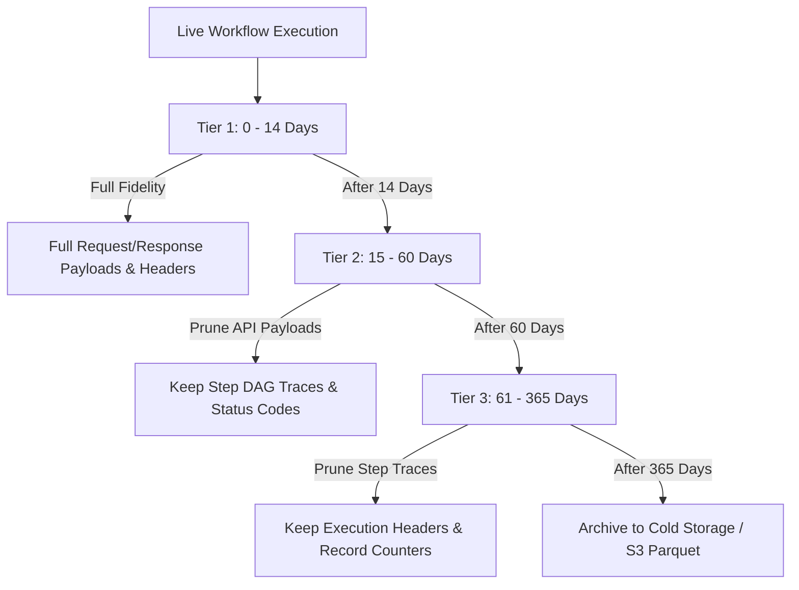

# Flowsmith Logs & Monitoring Operations Guide

## 1. Operational Overview

This guide provides Site Reliability Engineers (SREs), system administrators, and integration operators with procedures for monitoring, alerting, maintaining, and scaling Flowsmith's Logs & Monitoring infrastructure in production environments.

---

## 2. Prometheus & OpenTelemetry Metrics

Flowsmith exports operational metrics via `GET /metrics` and OpenTelemetry collectors.

### 2.1 Core Telemetry Metrics

| Metric Name | Type | Labels | Description |
| :--- | :--- | :--- | :--- |
| `flowsmith_executions_total` | Counter | `status`, `trigger`, `workspace_id` | Cumulative execution runs |
| `flowsmith_executions_running` | Gauge | `workspace_id` | Number of currently executing workflows |
| `flowsmith_execution_duration_seconds` | Histogram | `workflow_id`, `status` | Execution latency distribution |
| `flowsmith_api_requests_total` | Counter | `connector`, `status_code`, `method` | Outbound connector API requests |
| `flowsmith_api_request_duration_seconds`| Histogram | `connector`, `operation` | Latency of 3rd-party connector calls |
| `flowsmith_retries_total` | Counter | `retry_trigger`, `status` | Cumulative retry attempts |
| `flowsmith_records_processed_total` | Counter | `connector`, `object_type` | Total records ingested/synced |

### 2.2 Recommended Prometheus Alerting Rules

```yaml
groups:
  - name: flowsmith_monitoring_alerts
    rules:
      # Alert when workflow failure rate exceeds 10% over 5 minutes
      - alert: HighExecutionFailureRate
        expr: (sum(rate(flowsmith_executions_total{status="failed"}[5m])) / sum(rate(flowsmith_executions_total[5m]))) > 0.10
        for: 5m
        labels:
          severity: warning
        annotations:
          summary: "Flowsmith integration failure rate elevated (> 10%)"
          description: "Workflow failures have exceeded 10% for workspace {{ $labels.workspace_id }}."

      # Alert when upstream connector rate limiting surges
      - alert: UpstreamRateLimitSurge
        expr: sum(rate(flowsmith_api_requests_total{status_code="429"}[5m])) > 5
        for: 2m
        labels:
          severity: warning
        annotations:
          summary: "Connector rate limits being hit: {{ $labels.connector }}"
          description: "Connector {{ $labels.connector }} is returning HTTP 429 rate limit responses."

      # Alert when executions are stuck running
      - alert: StuckExecutionWarning
        expr: flowsmith_executions_running > 50
        for: 15m
        labels:
          severity: critical
        annotations:
          summary: "High volume of long-running executions"
          description: "Over 50 executions have been running for > 15 minutes."
```

---

## 3. Data Retention & Pruning Lifecycle

High-volume integration hubs generate millions of step traces and API request logs. Flowsmith implements tiered retention to balance historical audit compliance with storage efficiency.



### 3.1 Recommended Retention Tiers
1. **Tier 1 (0 to 14 Days):** Full diagnostic fidelity. Includes all request and response bodies, raw headers, and step outputs.
2. **Tier 2 (15 to 60 Days):** Prune heavy JSON payloads from `api_request_logs` while retaining HTTP status codes, latencies, and `execution_steps`.
3. **Tier 3 (61 to 365 Days):** Retain high-level `executions` summary headers and record counters for compliance reporting. Prune granular `execution_steps`.
4. **Cold Archive (> 365 Days):** Stream old rows to Parquet/S3 and purge from the relational database.

### 3.2 Automated Pruning Script
Run via nightly cron job:
```bash
# In backend directory
python -c "
from app.db import session_scope
from datetime import datetime, timezone, timedelta
from app.models.monitoring_telemetry import ApiRequestTelemetry, ExecutionStep

with session_scope() as session:
    cutoff_14d = datetime.now(timezone.utc) - timedelta(days=14)
    cutoff_60d = datetime.now(timezone.utc) - timedelta(days=60)
    
    # Null out large payloads older than 14 days
    session.query(ApiRequestTelemetry).filter(ApiRequestTelemetry.created_at < cutoff_14d).update({
        'request_payload': None,
        'response_payload': None,
        'payload_truncated': True
    }, synchronize_session=False)
    
    # Delete API logs older than 60 days
    session.query(ApiRequestTelemetry).filter(ApiRequestTelemetry.created_at < cutoff_60d).delete(synchronize_session=False)
    session.commit()
    print('Telemetry pruning complete.')
"
```

---

## 4. Database Index Tuning & Maintenance

### 4.1 PostgreSQL Optimization
For high-throughput PostgreSQL deployments:

1. **Autovacuum Tuning:**
   ```sql
   ALTER TABLE executions SET (autovacuum_vacuum_scale_factor = 0.05);
   ALTER TABLE execution_steps SET (autovacuum_vacuum_scale_factor = 0.05);
   ALTER TABLE api_request_logs SET (autovacuum_vacuum_scale_factor = 0.05);
   ```

2. **Index Re-indexing:**
   Perform concurrent re-indexing monthly to prevent index bloat:
   ```sql
   REINDEX TABLE CONCURRENTLY executions;
   REINDEX TABLE CONCURRENTLY execution_steps;
   REINDEX TABLE CONCURRENTLY api_request_logs;
   ```

3. **Table Partitioning (for >10M rows/month):**
   Partition `executions`, `execution_steps`, and `api_request_logs` by month using PostgreSQL range partitioning on `started_at` or `created_at`.

---

## 5. Operational Runbooks

### Runbook 1: Triaging a Connector Failure Surge

**Symptoms:**
- Monitoring dashboard shows a sharp drop in `success_rate_percent`.
- `error_distribution` shows a surge in `RATE_LIMIT` or `UPSTREAM_5XX`.

**Action Steps:**
1. Navigate to **Monitoring** (`/monitoring`) and click on the surging error chip (e.g. `RATE_LIMIT`).
2. The UI automatically navigates to **Execution Logs** filtered by that error category.
3. Select a failed execution to open the **Execution Inspector**.
4. Open the **API Inspector** tab to view outbound requests.
5. Check the `Retry-After` header in the response payload to determine the backoff window.
6. Verify connector credentials in **Settings > Credentials** if the failure type is `AUTHENTICATION`.

---

### Runbook 2: Investigating Stuck / Long-Running Executions

**Symptoms:**
- `flowsmith_executions_running` metric remains elevated.
- Executions appear in "running" status for more than 15 minutes.

**Action Steps:**
1. Navigate to **Execution Logs** and filter by `Status: running`.
2. Inspect the latest running execution.
3. In the **Timeline** tab, identify the node where execution stalled.
4. If the node is waiting on an external webhook response or human approval, verify if the timeout policy is configured.
5. To gracefully terminate a stuck execution:
   ```bash
   curl -X POST https://flowsmith.local/api/executions/<id>/cancel \
     -H "Authorization: Bearer <token>"
   ```

---

### Runbook 3: Safely Replaying Failed Runs at Scale

**Symptoms:**
- An upstream vendor (e.g. Salesforce or NetSuite) suffered a 30-minute outage that has now been resolved.
- Hundreds of executions failed with `NETWORK_ERROR` or `UPSTREAM_5XX`.

**Action Steps:**
1. Navigate to **Execution Logs**.
2. Filter by `Status: failed` and `Connector: NetSuite`.
3. Open the failed execution.
4. Click **Retry Execution**. The dialog will present the snapshotted workflow version and automatically supply an `idempotency_key`.
5. Submit the retry. Flowsmith executes the run against the saved snapshot and logs the new execution in the **Retry History** tab.
6. Confirm that the new attempt reaches `completed` status and processed record counters match expected volumes.
