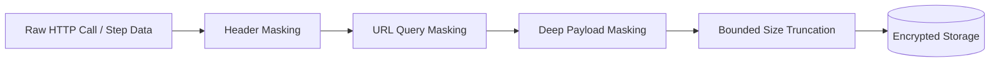

# Flowsmith Logs & Monitoring Security Guide

## 1. Security Overview

Flowsmith processes mission-critical integration workloads that frequently transmit authentication tokens, sensitive customer records, financial transactions, and proprietary business schemas. The Logs & Monitoring module adheres to strict **defense-in-depth** security practices, ensuring that diagnostic visibility never compromises multi-tenant isolation, data privacy, or compliance postures (SOC 2, GDPR, HIPAA, PCI-DSS).

---

## 2. Multi-Tenant Isolation & Access Control

### 2.1 Workspace and Organization Scoping
Every execution, step trace, outbound API request log, and retry record is strictly partitioned by `organization_id` and `workspace_id`. Access is governed by Flowsmith's centralized authorization helper `accessible_ids(db, user)`:

```python
# app/api/executions.py
ids = accessible_ids(db, user)
if not ids:
    return ok([], {"page": 1, "pageSize": size, "total": 0})

stmt = select(Execution).where(Execution.workflow_id.in_(ids))
```

### 2.2 Prevention of Identity & Resource Enumeration
If a tenant attempts to access, inspect, or retry an execution belonging to another tenant:
- The system returns **`404 Not Found`** instead of `403 Forbidden`.
- This ensures an attacker cannot enumerate valid execution IDs or determine whether an execution exists in another workspace.

### 2.3 Parameterized Queries
All database queries are formulated using SQLAlchemy 2.0 select constructs with parameter bindings, eliminating SQL injection risks across search strings, date ranges, and status filters.

---

## 3. Secret Redaction & Data Sanitization

Diagnostic logs capture outbound HTTP communications, including headers, query parameters, and request/response payloads. Flowsmith enforces redaction **at capture time** before data is committed to disk or serialized to clients.



### 3.1 HTTP Header Masking
The `redact_headers` function scrubs authentication, credentials, and cookie headers:
```python
SENSITIVE_HEADER_KEYS = {
    "authorization",
    "proxy-authorization",
    "x-api-key",
    "x-auth-token",
    "cookie",
    "set-cookie",
    "api-key",
    "apikey",
}
```
Any header matching these names is masked as `[REDACTED]`.

### 3.2 URL Query Parameter Redaction
The `redact_url` utility uses standard URI parsing to extract query components. Query parameters containing sensitive keys (`key`, `token`, `secret`, `auth`, `api_key`, `access_token`, `signature`) have their values replaced with `[REDACTED]`.

### 3.3 Deep Recursive Payload Masking
The `redact_payload` utility traverses JSON objects and nested dictionaries recursively. Any key containing substring tokens such as:
- `password`, `secret`, `token`, `access_token`, `refresh_token`
- `private_key`, `client_secret`, `api_key`, `apikey`, `auth`
- `card_number`, `cvv`, `ssn`

is overwritten with `"[REDACTED]"`.

### 3.4 Bounded Payload Truncation (DoS Defense)
To prevent adversarial inputs or massive binary responses (e.g. 50MB file downloads) from exhausting database storage or memory during log inspection, payloads exceeding `max_length=65536` (64KB) are cleanly truncated and tagged with `payload_truncated=True`.

---

## 4. CSV Formula Injection Defense (CWE-1236)

When exporting execution logs to CSV, fields originating from upstream systems (such as workflow names, trigger inputs, connector responses, or error summaries) could contain malicious formulas designed to execute commands in spreadsheet applications (Microsoft Excel, LibreOffice Calc, Apple Numbers, Google Sheets).

### 4.1 Dangerous Prefix Characters
Any cell beginning with:
- `=` (e.g., `=CMD|' /C calc'!A0`)
- `+` (e.g., `+1+2`)
- `-` (e.g., `-2+3`)
- `@` (e.g., `@SUM(...)`)
- `\t` (Tab character)
- `\r` (Carriage return)

### 4.2 Sanitization Implementation
Flowsmith processes every single CSV cell through `sanitize_csv_cell`:
```python
# app/engine/redact.py
def sanitize_csv_cell(value: Any) -> str:
    """Escapes characters that could trigger spreadsheet formula execution."""
    if value is None:
        return ""
    text = str(value)
    if text and text[0] in ("=", "+", "-", "@", "\t", "\r"):
        return "'" + text
    return text
```
Preceding the dangerous character with a single quotation mark (`'`) instructs the spreadsheet engine to treat the value purely as literal text, completely neutralizing formula execution.

---

## 5. Retry Safety & Idempotency Safeguards

Automated or manual workflow reruns in integration platforms pose significant risk if replayed without idempotency guards (e.g., double-charging a credit card or creating duplicate invoices).

### 5.1 Idempotency Key Validation
Every retry request accepts an `idempotency_key` (generated by the client UI or caller).
1. `ExecutionRetryHistory` stores `retry_policy` as the unique idempotency token.
2. If the same `idempotency_key` is submitted more than once, the endpoint short-circuits execution, retrieves the previously created retry run, and returns:
   ```json
   {
     "execution_id": "<original_retry_id>",
     "status": "queued",
     "idempotent_replay": true
   }
   ```
3. No redundant workflow run or duplicate downstream API calls are generated.

### 5.2 Immutable Snapshots
Retries do not execute against mutable live workflows. Instead, Flowsmith executes against the immutable `workflow_data` snapshot saved with the original execution record, ensuring that mid-flight workflow changes do not corrupt replay outcomes.

---

## 6. Audit Trail & Export Accountability

All sensitive monitoring actions are recorded to the immutable `audit_events` ledger:
- `EXECUTION_EXPORT` (`execution.export`): Logs every CSV export event with user ID, IP address, requested filters, timestamp, and row count.
- `EXECUTION_RETRY` (`execution.retry`): Logs every manual and automated replay attempt with originating execution ID, target node ID, and initiating identity.
