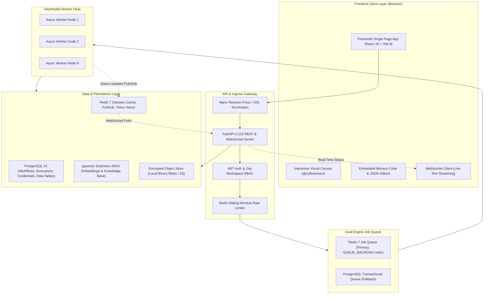

# Flowsmith — Enterprise Technology Stack & Architecture Specification

> **Document Version**: 2.5.0  
> **Classification**: Technical Architecture & Leadership Brief  
> **Product Category**: Enterprise Integration Platform as a Service (iPaaS) & Autonomous Workflow Orchestrator  

---

## Executive Summary

**Flowsmith** is an enterprise-grade, cloud-agnostic Integration Platform as a Service (iPaaS) and visual workflow orchestration engine. Built in the same architectural class as *n8n*, *Zapier*, and *Workato*, Flowsmith enables organizations to visually design, schedule, and execute complex, event-driven directed acyclic graph (DAG) automations, multi-agent AI pipelines, and enterprise data integrations with strict zero-trust data governance.

---

## High-Level Architecture Diagram

---

## 1. Frontend Technology Stack (User Interface & Canvas)

The frontend is a single-page web application (SPA) optimized for low latency, smooth 60fps graph manipulations, and reactive live execution telemetry.

| Component | Technology | Version | Purpose & Rationale |
| :--- | :--- | :--- | :--- |
| **Core Framework** | **React** | 19.2.x | High-performance reactive UI rendering with React 19 Concurrent Mode. |
| **Build & Bundler** | **Vite** | 8.2.x | Lightning-fast ESM development server and optimized rollup production bundles. |
| **Interactive Canvas** | **React Flow (`@xyflow/react`)** | 12.11.x | Specialized graph canvas library handling smooth zooming, panning, drag-and-drop node snapping, custom handles, and edge routing. |
| **Code & JSON Editor** | **Monaco Editor** | 0.56.x | The official code editor engine powering Visual Studio Code. Provides syntax highlighting, auto-completion, linting, and formatting for custom JavaScript snippets and JSON schemas. |
| **State Management** | **Zustand** | 5.0.x | High-speed, unopinionated, decoupled reactive state management without unnecessary re-renders. |
| **Client Routing** | **React Router DOM** | 7.18.x | Client-side routing, route-level authorization guards, and deep-linking into specific workflow node configurations. |
| **Design System** | **Vanilla CSS + Modern Tokens** | — | Custom glassmorphism dark-mode design system with responsive slide-over panels, modals, and micro-animations. |
| **Frontend Testing** | **Vitest** + **Playwright** | Latest | Unit testing, coverage reporting (v8), and multi-browser End-to-End integration testing. |

---

## 2. Backend Technology Stack (API & Application Gateway)

The backend is built on asynchronous Python, adopting non-blocking I/O to handle thousands of concurrent API requests, webhooks, and live WebSocket streaming connections.

| Component | Technology | Version | Purpose & Rationale |
| :--- | :--- | :--- | :--- |
| **Runtime Language** | **Python** | 3.12 | Modern, typed async runtime leveraging Python 3.12 performance optimizations and native asyncio primitives. |
| **Web & ASGI Framework** | **FastAPI** | 0.111+ / 0.115+ | High-throughput async web framework with automatic OpenAPI / Swagger interactive documentation and dependency injection. |
| **ASGI Server** | **Uvicorn** | 0.30+ | Production ASGI web server running with multi-worker process management. |
| **Real-Time Streaming** | **WebSockets (`websockets`)** | 13+ | Sub-millisecond bi-directional streaming protocol pushing live execution state, node progression, and console logs directly to client browsers. |
| **Data Validation** | **Pydantic v2** | 2.7+ | Ultra-fast data validation and settings management implemented in Rust. |
| **HTTP Client** | **HTTPX** | 0.27+ | Connection-pooled, asynchronous HTTP/2 client for outbound connector execution and REST API calls. |

---

## 3. Workflow & Orchestration Engine

The proprietary execution engine is designed for deterministic, fault-tolerant workflow execution.

| Capability | Implementation | Description |
| :--- | :--- | :--- |
| **Graph Resolution** | **Topological DAG Sorter** | Analyzes workflow node dependencies, parallel branches, conditional splits (`If`, `Switch`), merges, and cycles. |
| **Script Sandboxing** | **Dukpy (Embedded JavaScript Engine)** | Evaluates user-authored JavaScript functions within an isolated, memory-bounded sandbox preventing unauthorized host filesystem or network access. |
| **Expression Syntax** | **Token Evaluation Engine** | Dynamically resolves cross-node reference expressions such as `{{ $('NodeName').item.json.field }}` and Jinja-style templates. |
| **Workflow Scheduling** | **Croniter + Python AsyncIO** | High-precision scheduler supporting 5-field and 6-field standard UNIX cron expressions with automatic drift compensation. |
| **Failure Recovery** | **Exponential Backoff & Jitter** | Configurable auto-retry policies with exponential delay, dead-letter queues, and pause-for-approval human-in-the-loop states. |

---

## 4. Database, Vector & Persistence Layer

Flowsmith uses an enterprise relational storage engine coupled with native vector capabilities for AI workloads.

| Component | Technology | Version | Purpose & Rationale |
| :--- | :--- | :--- | :--- |
| **Primary Relational DB** | **PostgreSQL** | 16 | ACID-compliant transactional persistence for users, organizations, workspaces, workflows, execution records, credentials, and data tables. |
| **ORM & Driver** | **SQLAlchemy 2.0** + **Psycopg 3** | Latest | Modern 2.0-style type-annotated ORM utilizing the high-performance binary wire protocol of Psycopg 3. |
| **Schema Migrations** | **Alembic** | 1.13+ | Transactional DDL migration framework with PostgreSQL advisory locks (`FLOWSMITH_MIGRATION_LOCK_ID`) preventing concurrent migration races during rolling deployments. |
| **Vector Storage (AI/RAG)**| **`pgvector` Extension** | Native | Vector similarity search utilizing HNSW and IVFFlat indexing for high-speed nearest-neighbor retrieval in Retrieval-Augmented Generation (RAG) pipelines. |
| **Binary & Object Storage**| **Encrypted Local / S3-Compatible** | Custom | Secure chunked object store for large execution payloads, uploaded datasets, CSVs, PDF files, and media. |

---

## 5. Message Broker, Queuing & Distributed Workers

Flowsmith decouples workflow trigger ingress from execution via a distributed task queue.

| Component | Technology | Description |
| :--- | :--- | :--- |
| **Message Broker** | **Redis 7 (Alpine)** | In-memory distributed queue supporting atomic job leasing (`RPOPLPUSH`), delayed queue scheduling, distributed locks (`Redlock`), and Pub/Sub notifications. |
| **Worker Fleet** | **Decoupled Worker Daemon (`app.queue.worker`)** | Stateless, horizontally scalable worker instances. Workers independently lease jobs from Redis, execute the DAG steps, stream telemetry, and persist outputs. |
| **Transactional Fallback** | **PostgreSQL Transactional Queue** | Automatic fallback queue implementation ensuring zero message loss if Redis is temporarily unreachable or for single-node air-gapped deployments. |

---

## 6. Security, Cryptography & Governance

Flowsmith is engineered from the ground up to satisfy enterprise security audits (SOC 2, GDPR, HIPAA alignment).

| Security Domain | Implementation | Description |
| :--- | :--- | :--- |
| **Credential Encryption** | **AES-256-GCM (`cryptography`)** | All third-party API keys, OAuth access tokens, refresh tokens, and passwords are encrypted at rest using authenticated AES-256-GCM with PBKDF2-derived keys. |
| **User Authentication** | **JWT (HMAC-SHA256) + PBKDF2/Argon2** | Stateless JSON Web Tokens with sliding expiration, refresh tokens, and cryptographically salted password hashing. |
| **SSO & Federated Identity** | **OAuth2 & OIDC** | Enterprise single sign-on support for Google Workspace, GitHub, and generic OpenID Connect (OIDC) identity providers. |
| **Multi-Tenancy & RBAC** | **Hierarchical Tenant Isolation** | Strict Organization-level and Workspace-level data segregation enforced at the database query layer. |
| **SSRF Protection** | **SafeHTTPClient** | Outbound HTTP requests block private/loopback IP address ranges (`127.0.0.1`, `10.0.0.0/8`, `169.254.169.254` AWS metadata) to prevent Server-Side Request Forgery. |
| **Telemetry Redaction** | **Automated Secret Masking** | Execution logs and HTTP egress traces automatically scan and mask passwords, client secrets, API tokens, and Authorization headers before persisting to disk. |

---

## 7. AI, Agents & Integration Ecosystem

Flowsmith features a modular connector architecture providing deep integration with AI models and enterprise platforms:

### AI & Agent Capabilities
- **Supported Providers**: OpenAI (`GPT-4o`), Anthropic (`Claude 3.5 Sonnet`), Google Gemini, and self-hosted **Ollama** LLMs.
- **Agent Features**: Autonomous multi-step tool-calling agents, conversation memory buffers, dynamic document chunking, and semantic vector search.

### Enterprise Connectors & Protocols
- **CRM & Cloud Platforms**: Salesforce (REST API & SOAP Outbound Messages), Microsoft Dynamics 365, HubSpot, Google Workspace.
- **Relational & NoSQL Databases**: PostgreSQL, MySQL (PyMySQL), MongoDB (PyMongo).
- **Communication & Protocols**: Universal REST/HTTP Client, GraphQL, Webhooks (Ingress & Egress), SSH/SFTP (Paramiko), SMTP/Email.

---

## 8. DevOps, Deployment & Infrastructure

| Layer | Technology | Details |
| :--- | :--- | :--- |
| **Containerization** | **Docker & Docker Compose** | Multi-stage Docker build producing a hardened, non-root Linux container (`appuser`) packaging Vite frontend assets, FastAPI backend, and worker daemons into a unified image. |
| **Reverse Proxy & Ingress** | **Nginx** | Reverse proxy handling TLS/SSL termination, HTTP/2 multiplexing, WebSocket connection upgrades, and connection buffering. |
| **Runtime OS** | **Linux (Debian/Ubuntu)** | Container base runtime (`python:3.12-slim`). |
| **CI/CD Pipeline** | **GitHub Actions** | Automated continuous integration checking code style (`Ruff`), static typing (`Pyright`), dependency vulnerabilities (`pip-audit`, `npm audit`), and running automated regression suites (`pytest`, `vitest`, `playwright`). |

---

## Summary for Leadership

> *"Flowsmith is an enterprise-grade workflow automation platform built on a modern **React 19 / Vite** visual canvas frontend and an asynchronous **Python 3.12 / FastAPI / Redis / PostgreSQL 16 (with pgvector)** backend, supporting distributed worker scaling and on-premise or cloud deployments."*
