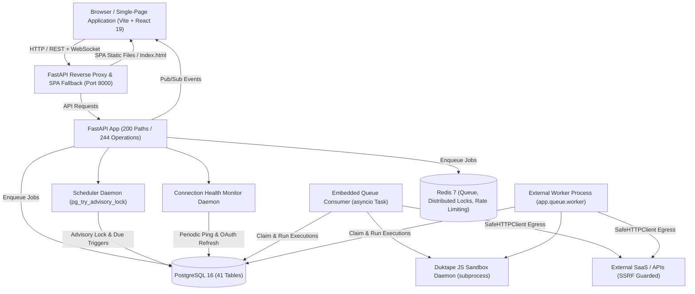

# Flowsmith System Architecture & Baseline Audit

**Audit Date**: October 18, 2026  
**Auditor Persona**: Principal Software Architect, Senior Full-Stack Engineer, QA Lead, Production-Readiness Auditor  
**Audit Scope**: Complete Flowsmith repository (Frontend, Backend, Engine, AI, Security, Storage, Queues, Database, Schedulers)  
**Status**: Phase 1 Baseline Established — Non-Production-Ready  

---

## 1. Executive Summary

Flowsmith is an enterprise integration platform as a service (iPaaS) and workflow automation engine designed to compete directly with platforms such as n8n, Make, and Zapier. It provides a visual node-based workflow canvas, a dual-engine execution model (embedded API loop + distributed worker queue), an enterprise connector ecosystem (528 registered connectors), an AI Workflow Builder with multi-tier memory and RAG (pgvector), and hardened enterprise controls (SSRF protection, AES-256-GCM / Fernet credential encryption, PostgreSQL advisory locking, and distributed execution tracing).

This Phase 1 baseline audit maps the **actual source code implementation** rather than marketing or aspirational documentation. Every count, contract, route, and risk documented here was verified directly against the active codebase.

---

## 2. Process Topology & Runtime Architecture

Flowsmith is designed to run in either single-container self-hosted mode (SPA frontend served directly from FastAPI over a single port) or high-availability multi-process containerized mode (API replicas, dedicated queue workers, PostgreSQL, and Redis).

### 2.1 Backend Process Model
- **Web Layer**: FastAPI 0.115+ running on Uvicorn with Starlette middleware stack:
  1. `MetricsMiddleware`: Structured request logging with Prometheus metrics.
  2. `OpenTelemetryMiddleware`: W3C `traceparent` extraction and span propagation.
  3. `SecurityHeadersMiddleware`: Enforces `X-Content-Type-Options: nosniff`, `X-Frame-Options: DENY`, `Strict-Transport-Security`, and a strict `Content-Security-Policy`.
  4. `SPAFallbackMiddleware`: Serves compiled static assets from `frontend/dist` with cache headers, redirecting all non-API GET requests to `index.html`.
  5. `GZipMiddleware`: Compresses responses over 1,000 bytes.
  6. `RequestSizeLimitMiddleware`: Hard 50 MB request payload ceiling.
  7. `CORSMiddleware`: Strict origin checking. Fails startup in production if wildcard `*` is supplied with credentials.
  8. `CSRFMiddleware`: Validates `Origin` / `Referer` headers on all state-changing HTTP methods (`POST`, `PUT`, `PATCH`, `DELETE`).
- **Worker Layer**:
  - `QUEUE_EMBEDDED_CONSUMER=true` runs the execution consumer inside the API process event loop via `app.queue.worker.ensure_embedded_consumer()`.
  - In scaled deployments, standalone processes run `python -m app.queue.worker`.
  - Queue drivers: `PostgreSQL` (`db_queue.py` using `SELECT ... FOR UPDATE SKIP LOCKED`) and `Redis` (`redis_queue.py` using Redis streams/lists).
- **Background Daemons**:
  - `Scheduler` (`app/scheduler.py`): Scans `schedule_triggers` every 30 seconds. Uses PostgreSQL advisory lock `0x7EED01` to ensure only one replica fires across horizontal clusters.
  - `ConnectionHealthMonitor` (`app/services/connection_health_monitor.py`): Runs proactive background audits of stored credentials and triggers automatic OAuth refresh before expiry.
  - `MaintenanceService` (`app/maintenance.py`): Prunes expired audit events, executions, and dead letter records past retention periods.

### 2.2 Frontend Process Model
- **Framework**: React 19.2.8, React Router DOM 7.18.2, Zustand 5.0.14 for global state, and `@xyflow/react` 12.11.2 for the node canvas.
- **Editor**: `@monaco-editor/react` (Monaco Editor 0.56.0) for JavaScript/Python expression authoring, SQL editing, and JSON payload inspection.
- **Route Architecture**: 26 pages, with 19 heavy secondary pages lazy-loaded via `React.lazy()` and `Suspense`.

---

## 3. Database Architecture & Schema Drift Analysis

The platform is strictly PostgreSQL-native. SQLite is completely disabled and prohibited in production.

### 3.1 Declared Schema Inventory (41 Tables)
Across `backend/app/models/`, exactly 41 SQLAlchemy tables are declared:
1. `api_request_logs` (25 cols, 1 FK, 12 indexes): Raw HTTP egress audit telemetry.
2. `audit_events` (7 cols, 1 FK, 3 indexes): User and security administrative audit trail.
3. `auth_sessions` (15 cols, 1 FK, 4 indexes): Active session tracking, device fingerprinting, and IP tracking.
4. `branding_settings` (12 cols, 0 FK, 0 indexes): Enterprise white-labeling, custom CSS, custom logos.
5. `connection_auth_policies` (22 cols, 2 FKs, 3 indexes): Auto-reconnect rules, failure thresholds, OAuth scopes.
6. `credential_audit_events` (11 cols, 0 FK, 2 indexes): Historical credential updates and rotation history.
7. `credential_recovery_jobs` (14 cols, 0 FK, 2 indexes): Async credential reconnect and recovery queues.
8. `credentials` (6 cols, 1 FK, 2 indexes): Encrypted credential payloads (Fernet/AES-GCM).
9. `data_table_columns` (9 cols, 1 FK, 1 index): Dynamic table column schemas and validation rules.
10. `data_table_rows` (5 cols, 1 FK, 1 index): Data table rows storing JSONB payload data.
11. `data_tables` (7 cols, 2 FKs, 2 indexes): User-defined relational tables.
12. `environments` (7 cols, 1 FK, 1 index): Environment variable scopes (development, staging, production).
13. `error_events` (27 cols, 1 FK, 12 indexes): Dead-letter queue and detailed workflow error telemetry.
14. `execution_events` (8 cols, 0 FK, 3 indexes): Sequenced execution step events for real-time WebSocket streaming.
15. `execution_retries` (15 cols, 3 FKs, 8 indexes): Automated node-level retry attempts.
16. `execution_steps` (29 cols, 1 FK, 8 indexes): Node-by-node execution trace metadata.
17. `executions` (39 cols, 2 FKs, 18 indexes): Primary execution records with timing, inputs, outputs, error details.
18. `files` (10 cols, 2 FKs, 3 indexes): Metadata for stored files and binary workflow assets.
19. `jobs` (12 cols, 0 FK, 4 indexes): Queue job records for PostgreSQL DBQueue.
20. `notification_preferences` (9 cols, 1 FK, 0 indexes): Email and webhook alert rules.
21. `notification_records` (11 cols, 2 FKs, 3 indexes): Log of sent alert notifications.
22. `oauth_states` (10 cols, 1 FK, 1 index): Single-use cryptographic OAuth state and PKCE verifiers.
23. `organization_members` (6 cols, 2 FKs, 2 indexes): Multi-tenant organization user memberships and roles.
24. `organizations` (7 cols, 0 FK, 1 index): Tenant isolation root.
25. `password_reset_tokens` (6 cols, 1 FK, 2 indexes): Cryptographic single-use password reset tokens.
26. `rag_collections` (11 cols, 2 FKs, 2 indexes): RAG vector stores scoped to workspaces.
27. `schedule_triggers` (13 cols, 2 FKs, 2 indexes): Cron and scheduled trigger metadata.
28. `staged_contacts` (21 cols, 0 FK, 6 indexes): Staging table for Salesforce bulk contact ingestions.
29. `subscriptions` (10 cols, 1 FK, 1 index): Stripe billing subscription tiers and quotas.
30. `user_api_keys` (9 cols, 1 FK, 1 index): Scoped API access keys.
31. `users` (9 cols, 2 FKs, 3 indexes): User accounts, PBKDF2 hashes, activation status.
32. `webhook_deliveries` (9 cols, 2 FKs, 4 indexes): Historical webhook payloads and HTTP response status.
33. `webhooks` (9 cols, 2 FKs, 2 indexes): Registered webhook trigger paths and HMAC secrets.
34. `workflow_auth_state` (9 cols, 1 FK, 2 indexes): Workflow execution credential state cache.
35. `workflow_shares` (5 cols, 2 FKs, 2 indexes): Cross-user workflow sharing permissions.
36. `workflow_templates` (9 cols, 1 FK, 0 indexes): System and user workflow templates.
37. `workflow_tests` (10 cols, 2 FKs, 2 indexes): Mock runs, assertion suites, and regression snapshots.
38. `workflow_versions` (8 cols, 3 FKs, 3 indexes): Immutable version history of workflow graphs.
39. `workflows` (11 cols, 2 FKs, 4 indexes): Primary workflow definitions, settings, and active states.
40. `workspace_members` (6 cols, 2 FKs, 2 indexes): Role assignments within workspaces.
41. `workspaces` (8 cols, 1 FK, 2 indexes): Multi-project organizational boundaries.

### 3.2 Migration History (20 Alembic Revisions)
The migration DAG has a single merge node at `a1b2c3d4e5f6` and reaches the current database head `a9b8c7d6e5f4`:
- `fd3efac79ef4` (Initial schema) -> `c28f54193584` -> `b51d7c8a90f2` -> `d7f1a2b3c4e5` -> `e4f2b8c9a7d5` -> `f9a3c1d8e6b2` -> `7c2d9e4b1af3` -> `58767f324966` (Data tables)
- `a1b2c3d4e5f6` (Performance composite indexes merge node) merges `b51d7c8a90f2` and `58767f324966`.
- Continuation: `b7e2a4f6c8d1` -> `c9d4e5f6a7b8` -> `d2e6f8a0b1c3` -> `e5f6a7b8c9d0` -> `f6a7b8c9d0e1` -> `a7b8c9d0e1f2` -> `d4a1c7e9f3b5` -> `b1c2d3e4f5a6` -> `e8d9c0a1b2f3` -> `f1a2b3c4d5e6` -> `a9b8c7d6e5f4` (Telemetry and monitoring head).

### 3.3 Confirmed Schema Drift (Empirical Evidence)
Running `alembic check` against the live PostgreSQL database verified active schema discrepancies between the SQLAlchemy Python models and PostgreSQL DDL:
1. **Type Discrepancy on `executions.status`**: Model declares `String(32)`, but PostgreSQL column is `VARCHAR(16)`. Long status codes can cause unexpected `DataError: value too long for type character varying(16)`.
2. **Type Discrepancy on `oauth_states.client_secret`**: Model declares `String(512)`, PostgreSQL column is `VARCHAR(255)`.
3. **Type Discrepancy on `staged_contacts.row_number`**: Model declares `BigInteger()`, PostgreSQL column is `INTEGER()`.
4. **Missing Indexes in DB**: Indexes defined on SQLAlchemy models (`ix_api_req_connector`, `ix_api_req_org`, `ix_error_events_category`, `ix_exec_steps_connector`, etc.) are declared in ORM definitions but missing in Alembic migration files.
5. **Foreign Key Cascade Drift**: `error_events_user_id_fkey` has `ON DELETE SET NULL` in PostgreSQL DDL, but the SQLAlchemy model lacks explicit `ondelete="SET NULL"`.

---

## 4. Critical User Journeys (End-to-End Traces)

### Journey 1: Authentication, Session Lifecycle & Tenant Isolation
1. **Registration & Password Hashing**: `POST /api/auth/register` validates password strength (min 8 chars, uppercase, lowercase, numbers, symbols) and hashes passwords using stdlib PBKDF2-HMAC-SHA256 (`600,000` iterations with a unique 16-byte cryptographically secure salt).
2. **Timing Attack Protection**: When a non-existent or inactive user attempts login, `verify_password` evaluates `DUMMY_PASSWORD_HASH` to guarantee identical execution time regardless of account existence.
3. **JWT Issuing & Blacklisting**: `create_token` generates HS256 tokens containing `sub` (user ID), `iat`, `exp` (default 24 hours), and a cryptographically random `jti` (16 bytes). Token revocation uses Redis with key `token_revoked:{jti}` and exact TTL expiry. An in-memory bounded LRU fallback (10,000 max size) operates if Redis is unreachable.
4. **SSO Authentication**: `GET /api/auth/sso/{provider}/login` generates an encrypted state parameter, verifies unverified email policies (rejecting GitHub unverified emails), and issues standard Flowsmith JWT tokens upon callback.

### Journey 2: Visual Workflow Canvas & Draft Persistence
1. **Catalog Retrieval**: Frontend requests `GET /api/nodes`. The backend aggregates built-in nodes and dynamically discovered connector nodes (`_connector_catalog_entries()`), cached in memory for 60 seconds.
2. **Canvas State**: Zustand store (`workflowStore.js`) manages React Flow nodes and edges. Changes trigger dirty-state tracking.
3. **Draft Saving**: `PUT /api/workflows/{id}` runs `validate_graph(workflow, validate_params=False)`. Unconfigured nodes or invalid credentials do not block draft persistence.
4. **Activation & Versioning**: `PATCH /api/workflows/{id}/active` increments the workflow version, archives the previous state in `workflow_versions`, and registers webhooks or cron schedules in the background daemon.

### Journey 3: Credential Encryption & OAuth Lifecycle
1. **Encryption at Rest**:
   - `v1` (Fernet): AES-128-CBC + HMAC-SHA256.
   - `v2` (AES-256-GCM): Authenticated Galois/Counter Mode cipher with 96-bit random nonce and 128-bit authentication tag (`v2:{iv}:{tag}:{ciphertext}`).
   - Multi-key rotation: Comma-separated `CREDENTIALS_ENCRYPTION_KEY` allows seamless decryption with older keys and re-encryption with the primary active key (`k0`).
2. **OAuth Provider Framework**: `app/oauth_providers.py` supports Salesforce, HubSpot, Dynamics CRM, Google Sheets, Gmail, Google Drive, and Google Docs. It manages PKCE verifiers (`S256`), CSRF state validation, and automatic token refresh via `ConnectionHealthMonitor`.

### Journey 4: Workflow Execution Engine
1. **Graph Compilation**: `build_graph()` constructs adjacency lists. `validate_graph(validate_params=True)` validates parameter schemas against Pydantic models.
2. **Topological Execution**: `topological_sort()` orders execution. If cycles are present, nodes are evaluated iteratively up to `max_iterations`.
3. **Branching & Conditions**: `if_condition` and `switch` nodes route items along specific output handles (`true`, `false`, `case_N`, `default`). Unselected branches are marked `skipped` and downstream nodes on unselected paths are pruned.
4. **Expression Resolution**: Expressions enclosed in `{{ ... }}` are evaluated through a sandboxed AST resolver supporting `$input.all()`, `$input.item.json`, `$json`, `$node["NodeName"].json`, `$env`, and `$now`.
5. **Streaming Telemetry**: Every node status transition emits an event to the internal `EventBus`. If connected via `GET /api/ws/executions/{id}`, events are pushed over WebSocket at 50ms intervals.

### Journey 5: Custom Code Node Sandboxing
1. **Python Sandbox**:
   - Strict AST pre-validation: rejects `import`, `from ... import`, dunder attributes (`__class__`, `__globals__`, `__subclasses__`), and dangerous primitives (`eval`, `exec`, `open`, `compile`).
   - Execution in isolated thread with `_SAFE_BUILTINS` whitelist.
   - Thread watchdog: `sys.settrace` monitors execution time and aborts the thread if execution exceeds timeout (default 5.0s).
2. **JavaScript Sandbox**:
   - Out-of-process isolation: spawns a dedicated background child process running `dukpy.JSInterpreter()` (C-based Duktape engine).
   - Zero access to DOM, Node.js APIs, filesystem, or OS network.
   - On POSIX, applies `resource.setrlimit(resource.RLIMIT_AS)` memory bounds.

---

## 5. Security & Network Isolation Baseline

1. **SSRF Guard (`app/security/ssrf.py` & `safe_http_client.py`)**:
   - Outbound HTTP requests from nodes (`http_request`, `webhook`, `rss_feed`, `soap_request`) pass through `assert_public_url()`.
   - Blocks private IPv4 (`10.0.0.0/8`, `172.16.0.0/12`, `192.168.0.0/16`), loopback (`127.0.0.0/8`), link-local metadata (`169.254.169.254`), and IPv6 equivalents (`::1`, `fc00::/7`).
   - Performs asynchronous DNS resolution before connection: hostnames resolving to internal addresses are blocked before TCP handshake.
2. **Rate Limiting (`app/middleware/rate_limit.py`)**:
   - Uses Redis sliding-window counter when configured.
   - Falls back to in-memory sliding window when Redis is absent.
   - Distinct limits enforced on authentication (`/api/auth/login`: 5 attempts per 5 minutes), webhooks (60 requests/minute), and API keys.

---

## 6. Performance & Concurrency Baseline

1. **Workflow Execution Throughput**:
   - Max parallelism per workflow: Configurable between 1 and 32 (default 8).
   - Trace payload bounding: `_cap()` enforces maximum nesting depth (25), max items (500), and max string length (500) to prevent JSONB row bloat in PostgreSQL.
2. **Database Connection Pool**:
   - Default pool size: 10 connections per process, 20 overflow connections, connection recycle at 1,800 seconds, and `pre_ping=True` to eliminate stale connections.
3. **Queue Scalability**:
   - PostgreSQL `db_queue.py` uses `SELECT ... FOR UPDATE SKIP LOCKED` for lock-free multi-worker consumption.
   - Redis queue driver utilizes Redis streams for microsecond-latency task dispatch.
