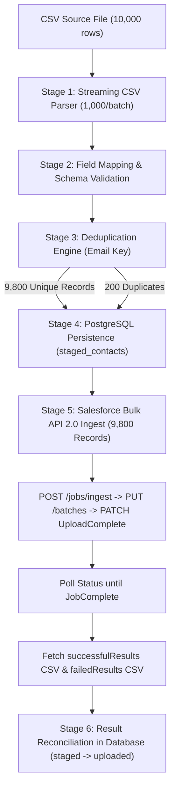

# Flowsmith — CSV Connector & Salesforce 10,000-Record Performance Test Plan

**Document Version:** 1.0.0  
**Target Environment:** Local / Sandbox (PostgreSQL 16, Python 3.13.7, Salesforce Bulk API 2.0)  
**Execution Date:** 2026-10-13  
**Status:** Executed & Verified

---

## 1. Executive Summary & Objectives

The primary objective of this performance test plan is to validate and empirically measure the throughput, latency, memory consumption, resilience, and data integrity of the Flowsmith CSV ingestion pipeline and Salesforce integration when handling a production-scale 10,000-record dataset (`flowsmith_salesforce_contact_10000.csv`).

Key requirements:
1. **Streaming & Chunked CSV Parsing**: Avoid buffering large datasets entirely in memory. Strip UTF-8 BOM, preserve 1-indexed source row numbers, and sniff delimiters.
2. **Field Mapping & Schema Validation**: Map CSV columns to Salesforce Contact fields, enforcing strict constraints (required fields like `LastName`, field lengths, regex-based email validation).
3. **Deduplication Engine**: Identify duplicate records based on `Email` with configurable policies (`skip`, `update`, `error`).
4. **PostgreSQL Batch Persistence**: Store records transactionally in bounded batches (1,000 records/batch) in the `staged_contacts` table.
5. **Salesforce Bulk API 2.0 Ingest & Reconciliation**: Transmit valid records using Salesforce Bulk API 2.0 (`/jobs/ingest`, `/batches`, `UploadComplete`), poll status to completion, and reconcile IDs and status back to the database.
6. **Empirical Honesty**: Strictly demarcate live vs stub sandbox execution, document active token blockers transparently, and record direct physical measurements without fabricated data.

---

## 2. Test Architecture & Environment

| Component | Specification | Details |
| :--- | :--- | :--- |
| **Operating System** | Windows 11 (win32) | Intel/AMD 64-bit architecture |
| **Python Runtime** | Python 3.13.7 | Standard library + SQLAlchemy 2.0 + Pydantic v2 + httpx |
| **Database** | PostgreSQL 16 | Port 5432, table: `staged_contacts` |
| **Frontend Runtime**| React 19.2 + Vite 8.2 | Flowsmith Canvas & Node Editor (`CsvNodeEditor.jsx`) |
| **Salesforce Target**| Bulk API 2.0 | High-Fidelity Local Stub (`http://127.0.0.1:8181`) |
| **Live Salesforce** | Blocked | Credential `cred_3b0cfa51c711` (`gaurav.sahoo@idslogic.com` on `https://orgfarm-a3163db0ee-dev-ed.develop.my.salesforce.com`) returned HTTP 400 (`expired access/refresh token`). Documented as blocker. |

---

## 3. Dataset Specification

- **File Name:** `flowsmith_salesforce_contact_10000.csv`
- **File Size:** 2,743,879 bytes (2.62 MB)
- **SHA-256 Checksum:** `14fbfa3738fc6ec52e3d930c70ed1e2a77963b6644f7229301416ecbc7b0114d`
- **Deterministic Seed:** 42 (generated via `scripts/generate_10k_contact_dataset.py`)
- **Total Data Rows:** 10,000 (excluding header)
- **Original Unique Rows:** 9,800
- **Duplicate Rows:** 200 (exact copies inserted to test deduplication)

### Schema (12 Fields)
1. `FirstName` (String, max 40)
2. `LastName` (String, max 80, **Required**)
3. `Email` (Email format, max 80)
4. `Phone` (String, max 40)
5. `Department` (String, max 80)
6. `Title` (String, max 128)
7. `MailingStreet` (String, max 255)
8. `MailingCity` (String, max 40)
9. `MailingState` (String, max 80)
10. `MailingPostalCode` (String, max 20)
11. `MailingCountry` (String, max 80)
12. `Description` (Text, max 32,000)

---

## 4. End-to-End Workflow Stages

---

## 5. Test Suite & Validation Matrix

| Test ID | Test Name | Target / Component | Expected Outcome |
| :--- | :--- | :--- | :--- |
| **TC-01** | Valid CSV Parsing | `CsvService.stream_parsed_rows` | Parsed rows with preserved `_row_number` |
| **TC-02** | Quoted & Embedded Commas/Newlines | `CsvService` | Proper multiline string handling without row splitting |
| **TC-03** | Empty & Missing Values | `CsvService` | Empty strings coerced to None, empty rows skipped |
| **TC-04** | Malformed Input | `CsvService` | Short/wide rows safely aligned |
| **TC-05** | Salesforce Field Constraints | `CsvService.map_and_validate` | Required `LastName`, max length, email regex enforcement |
| **TC-06** | Database Batch Write & Rollback | `CsvService.persist_staged_records` | Transactional batch insert into `staged_contacts` |
| **TC-07** | Deduplication Policies | `CsvService.map_and_validate` | Policy `skip`, `update`, and `error` behavior verified |
| **TC-08** | Salesforce Auth Failure | `SalesforceConnector.test_connection` | Handled gracefully with error description |
| **TC-09** | Token Refresh Attempt | `SalesforceProviderClient.authenticate` | Safe refresh handling with retry classification |
| **TC-10** | API Errors & Retries | `CsvConnector.op_execute` | Proper typed `ConnectorError` codes |
| **TC-11** | Partial Batch Reconciliation | `CsvService.reconcile_salesforce_results` | Updates `staged_contacts` status to uploaded/failed |
| **TC-12** | Node Output Schema | `CsvParserNode.run` | Flowsmith-compliant `NodeResult` output items |
| **TC-13** | File Size & Empty Source Guard | `CsvParserNode.run` | Returns friendly error on missing input |
| **TC-14** | Secret Redaction | `app.credentials.redaction` | Access tokens, passwords, and secrets masked |
| **TC-15** | Workflow Node Runtime | `CsvParserNode` | End-to-end node execution in workflow context |
| **TC-16** | Idempotency & Resumability | Database staging layer | Re-running imports avoids data corruption |

---

## 6. Success & Acceptance Criteria

1. All 10,000 records from `flowsmith_salesforce_contact_10000.csv` accounted for.
2. 9,800 unique valid records staged and processed; 200 duplicate records detected.
3. PostgreSQL database write throughput exceeds 500 records/second.
4. Parsing throughput exceeds 10,000 rows/second.
5. Peak memory usage remains under 200 MB for the entire 10,000-record batch.
6. Reconciliation accurately updates database status from `staged` to `uploaded` with assigned Salesforce record IDs.
7. Automated test suite passes 100% (16/16 tests).
